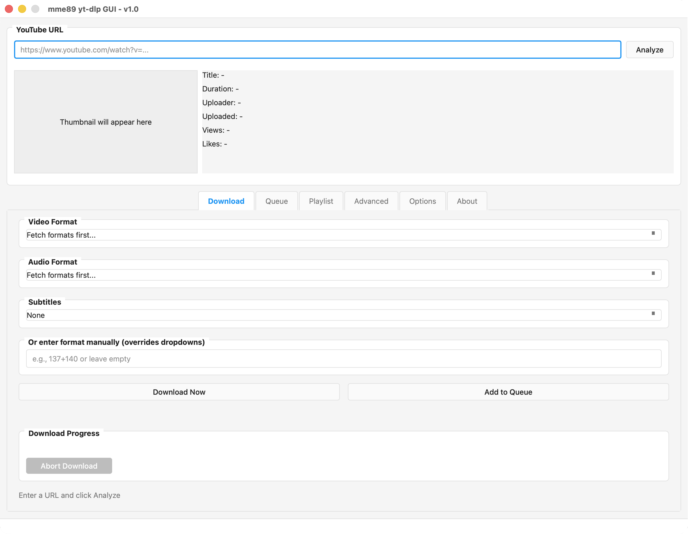
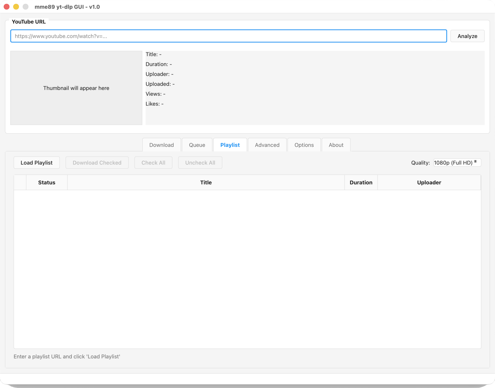
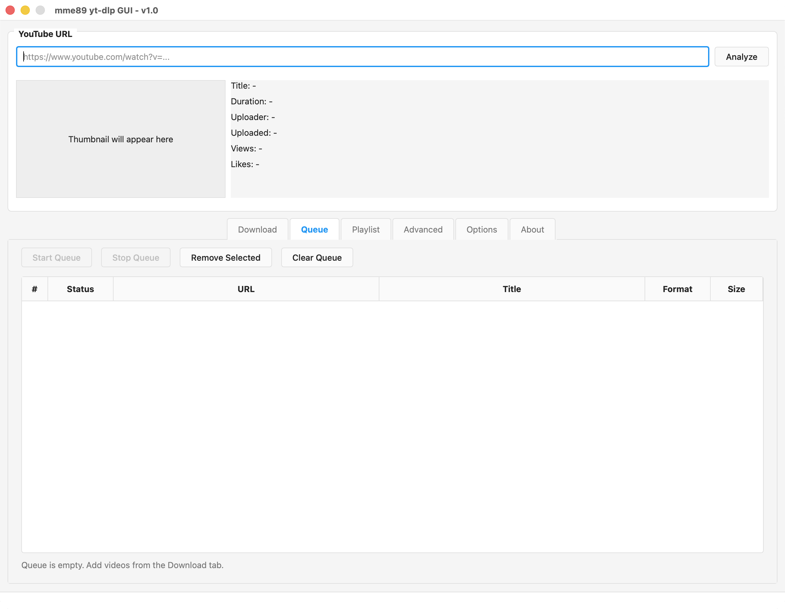

# yt-dlp GUI

[](https://github.com/mme89/yt-dlp-gui/releases/latest)
[](https://github.com/mme89/yt-dlp-gui/releases)
[](https://github.com/mme89/yt-dlp-gui/blob/main/LICENSE)
[](https://github.com/mme89/yt-dlp-gui)

A modern, cross-platform GUI wrapper for [yt-dlp](https://github.com/yt-dlp/yt-dlp). This application provides an easy-to-use graphical interface for downloading videos without using the command line.

## Screenshots

<div align="center">
  
  <p><em>Main download interface with format selection</em></p>
</div>

<div align="center">
  
  <p><em>Playlist management with selective downloads</em></p>
</div>

<div align="center">
  
  <p><em>Download queue for batch processing</em></p>
</div>

## Features

- 🎥 Download videos from YouTube
- 🎨 Clean, modern interface with cross-platform styling
- 📊 Format selection with detailed information (resolution, codec, file size)
- 📝 Subtitle support (auto-generated and manual)
- 📋 Download queue management
- 🎵 Playlist support with selective downloads
- 🖼️ Video thumbnail preview
- 📈 Real-time download progress tracking
- ⚙️ Advanced options and custom arguments
- 🪟 Separate terminal window for detailed output

## Requirements

This application requires [yt-dlp](https://github.com/yt-dlp/yt-dlp) and [FFmpeg](https://github.com/FFmpeg/FFmpeg) to be installed on your system.

- Use **yt-dlp 2026.10.26 or newer** for the latest bundled dependency security fixes. The GUI uses your separately installed yt-dlp; updating the GUI does not update yt-dlp.
- Python installations of current yt-dlp require **Python 3.11+**. Official Windows yt-dlp binaries require **Windows 10 or newer**. Pre-built GUI applications do not require a separate Python installation.
- Full YouTube support also requires EJS challenge solver scripts and a supported JavaScript runtime. Prefer **Deno 2.3+** or **Node.js 22+**. QuickJS 2023-12-09+ and all QuickJS-NG versions are supported. Bun is deprecated and supported only from 1.2.11 through 1.3.14.

The GUI automatically selects a supported runtime in this order: Deno, Node.js, QuickJS, then Bun. Unsupported or unrecognized versions are skipped. Explicit `--js-runtimes` and `--no-js-runtimes` custom options take precedence.

Official yt-dlp binaries already bundle EJS. For pip installations, install or upgrade yt-dlp and its default dependencies in the Python environment that runs yt-dlp:

```bash
python -m pip install -U "yt-dlp[default]"
```

For package-manager installations, upgrade through that package manager and check whether it includes EJS. The About tab does not verify EJS in the external yt-dlp installation; installing EJS into the GUI's Python environment alone may have no effect.

See the [yt-dlp EJS setup guide](https://github.com/yt-dlp/yt-dlp/wiki/EJS) and [2026.10.26 release notes](https://github.com/yt-dlp/yt-dlp/releases/tag/2026.10.26). If you suspect interception of your network traffic, upstream recommends manually replacing older official executables instead of using their self-updater.


## Installation

### Option 1: Download Pre-built Application (Recommended)

Download the latest release for your platform from the [Releases](https://github.com/mme89/yt-dlp-gui/releases) page:

- **macOS**: Download `yt-dlp-gui-mac.zip`, extract, and run the `.app`
- **Windows**: Download `yt-dlp-gui-windows.zip`, extract, and run the `.exe`
- **Linux**: Download `yt-dlp-gui-linux.tar.gz`, extract, and run the executable

### Option 2: Run from Source

1. Clone this repository:
```bash
git clone https://github.com/mme89/yt-dlp-gui.git
cd yt-dlp-gui
```

2. With Python 3.11 or newer, install the GUI dependencies (yt-dlp and FFmpeg must also be installed as described above):
```bash
pip install -r requirements.txt
```

3. Run the application:
```bash
python yt-dlp-gui.py
```

### Option 3: Build Standalone Application

If you want to create your own standalone executable:

**macOS:**
```bash
pyinstaller build-specs/yt-dlp-gui-mac.spec
```

**Windows:**
```bash
pyinstaller build-specs/yt-dlp-gui-windows.spec
```

**Linux:**
```bash
pyinstaller build-specs/yt-dlp-gui-linux.spec
```

The built application will be in the `dist/` folder.

## Usage

### Basic Workflow

1. Paste a YouTube URL in the input field
2. Click "Analyze" to fetch available formats
3. Select your preferred video and audio formats
4. Choose download location in the Options tab
5. Click "Download Now" or "Add to Queue"

### Features Guide

- **Download Tab**: Select formats and download individual videos
- **Queue Tab**: Manage multiple downloads sequentially
- **Playlist Tab**: Load and download entire playlists with quality presets
- **Advanced Tab**: Add custom yt-dlp arguments
- **Options Tab**: Configure download paths and yt-dlp location

## App updates

The GUI checks GitHub for a new stable GUI release shortly after startup and every seven days while running. When a newer release is available, it shows a notification with a **View release** button so you can download it. You can also use **About → Check for Updates** at any time.

Update checks run in the background. Offline connections and API limits do not interrupt downloads; you can retry from About. Checks use the public GitHub API without an account or token. Updates are installed manually, and this check covers the GUI rather than the separately installed yt-dlp executable.

## Configuration

Packaged applications save `settings.json` in the platform's user configuration directory and migrate legacy settings automatically. Source runs use the repository's `settings.json`.

Saved preferences include:

- Download path
- yt-dlp executable path
- Window preferences

## Troubleshooting

**"yt-dlp not found"**
- Ensure yt-dlp is installed and in your PATH
- Or specify the full path in Options → yt-dlp Path

**"FFmpeg not found"**
- Install FFmpeg and ensure it's in your PATH
- Required for merging separate video/audio streams

**Format fetching fails**
- Check your internet connection
- Verify the URL is valid
- Some videos may have region restrictions

## Note

This project was created with the assistance of AI to provide a user-friendly interface for yt-dlp.

## Contributing

Contributions are welcome! Feel free to open issues or submit pull requests.

Install the development dependencies into the same Python environment used to run the app:

```bash
python -m pip install -r requirements-dev.txt
```

Run the regression tests and check for lint errors:

```bash
QT_QPA_PLATFORM=offscreen python -m unittest discover -s tests -v
python -m pylint --errors-only yt_dlp_gui tests yt-dlp-gui.py
```

The tests also select the offscreen Qt backend automatically when none is configured, so the test command works without the environment prefix on Windows. Run Pylint without `--errors-only` to review style and complexity findings as well.

Shared Pylint settings live in `pyproject.toml`. They allow inspection of PySide6's compiled modules and handle the specific native Qt signals used by the app, without disabling import or member checks. The large main-window module retains a documented size exemption; its complexity findings remain visible. In VS Code, select the Python interpreter containing the app dependencies. Machine-specific interpreter paths belong in local settings, not the shared configuration.
